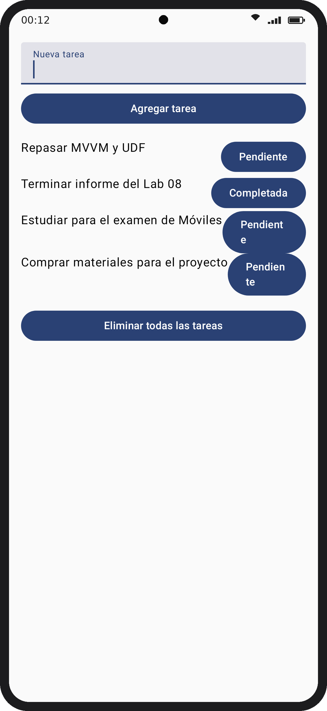
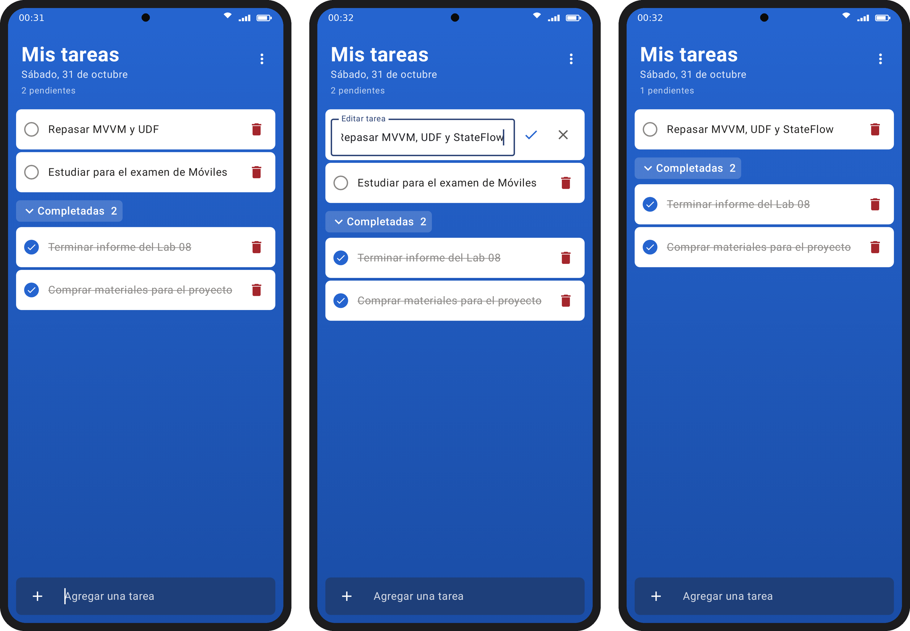

# Lab 08 – Arquitectura MVVM + UDF con persistencia de datos

Programación en Móviles · Sharon Jennifer Trujillo Sulca · Grupo D

App de tareas hecha con Kotlin, Jetpack Compose, Room y ViewModel.

## Contenido

| Parte | Qué hace | Archivos |
|---|---|---|
| Parte guiada (tag `parte-guiada`) | Agregar tareas, marcarlas como completadas y eliminar todas | `Task.kt`, `TaskDao.kt`, `TaskDatabase.kt`, `TaskViewModel.kt`, `MainActivity.kt` |
| Ejercicio 1 (tag `ejercicio1`) | Pantalla al estilo Microsoft To Do con **editar** y **eliminar** tareas una por una | `TaskScreen.kt`, `TaskViewModel.kt`, `TaskDao.kt` |

## Cómo está organizado (MVVM + UDF)

- **Model:** `Task` (entidad), `TaskDao` y `TaskDatabase` con Room.
- **ViewModel:** `TaskViewModel` expone un `StateFlow<TaskUiState>` y recibe los eventos de la pantalla.
- **View:** `TaskScreen` solo dibuja el estado y avisa los eventos (agregar, completar, editar, eliminar).

El estado baja del ViewModel a la pantalla y los eventos suben de la pantalla al ViewModel.

## Capturas

| Parte guiada | Ejercicio 1 |
|---|---|
|  |  |

## Cómo correrlo

Abrir el proyecto en Android Studio, esperar el *Sync* de Gradle y darle **Run** en un emulador.
